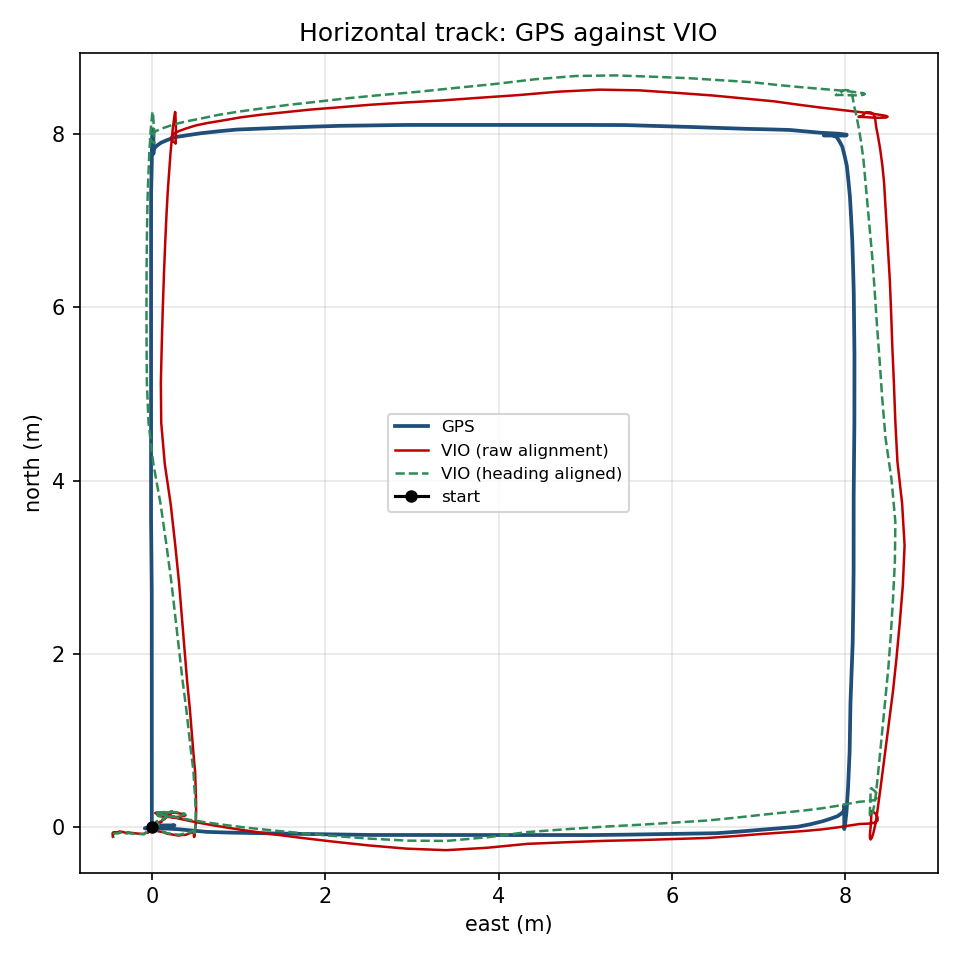
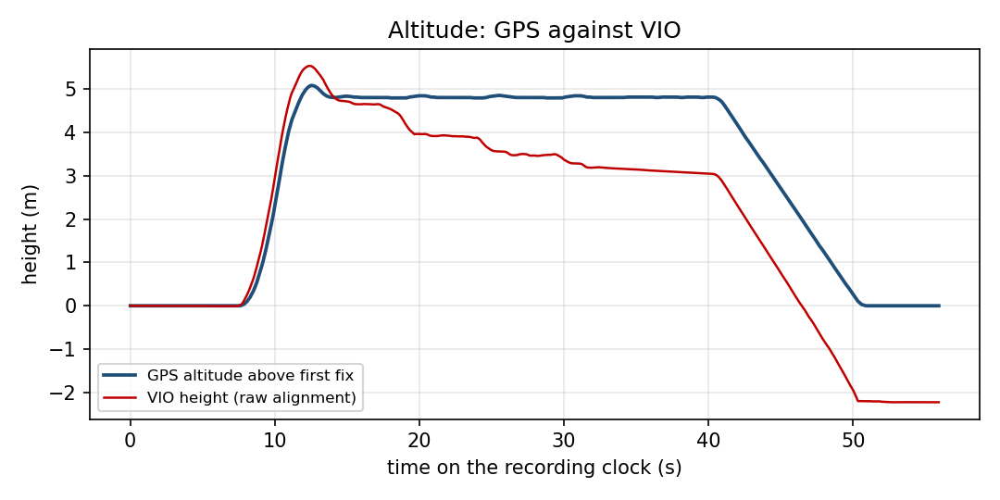
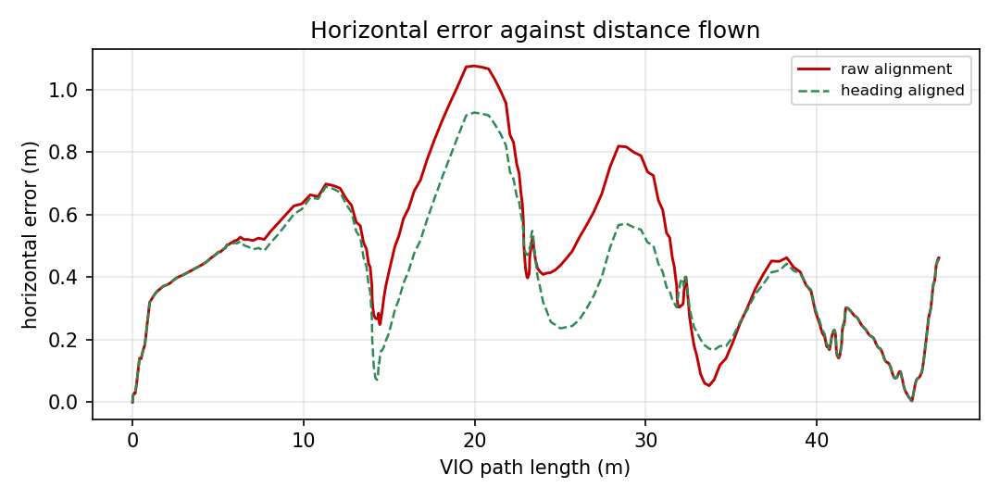

# Visual-inertial odometry against GPS, on a simulated quadcopter

This report covers Task 4: the recorded flight from Task 3 is replayed through
an offline monocular VIO, and the resulting track is compared with the
autopilot's own GPS solution. Every number below is read from files that exist
in this repository:

| What | Where |
|---|---|
| Recorded dataset (472 frames, IMU, GPS, attitude) | `results/task3/dataset_20261120_012619/` |
| Consumer of the dataset (the VIO) | `scripts/vio.py` |
| VIO output | `results/task3/vio_trajectory.csv` + `.json` |
| Comparison and metrics | `scripts/compare.py` |
| Metrics as run | `results/task4/metrics.csv`, `results/task4/compare.json` |
| Plots | `results/task4/xy_overlay.png`, `altitude.png`, `error.png` |

The pipeline is Python plus OpenCV and numpy. There is no ROS anywhere in it:
the camera is read with the Gazebo transport bindings (`gz.transport13`) and
the autopilot is spoken to over MAVLink with `pymavlink`.

---

## Aim

Demonstrate, with numbers rather than assertions, how well a monocular VIO that
uses the flight controller's gyro as an inertial prior recovers the trajectory
of a quadcopter flown in a square, using the autopilot's GPS as the reference.

Three questions are answered:

1. Does the VIO close the loop? A square returns to its start, so the distance
   between the first and last position is a drift measurement that does not
   need a time alignment.
2. How does the VIO's shape compare with GPS sample by sample? That is the ATE
   and the per-axis RMSE.
3. Where does it fail, and is the failure understood? The vertical axis is the
   weak one, and the report says why instead of hiding it.

---

## The flight

One flight, recorded by `scripts/record_dataset.py` in guided mode:

```
guided -> armed -> takeoff(5 m) -> altitude
       -> leg_north(8 m) -> leg_east(8 m) -> leg_south(8 m) -> leg_west(8 m)
       -> land -> disarm
```

| | |
|---|---|
| Simulated duration | 47.1 s of Gazebo time |
| Real time factor | 0.842 (so the run took ~56 s of wall clock) |
| Frames | 472 at 10 Hz, 0 dropped |
| IMU | `RAW_IMU` and `SCALED_IMU2` at 50.1 Hz |
| Attitude | `ATTITUDE` at 20.0 Hz |
| Position reference | `LOCAL_POSITION_NED` 10.0 Hz, `GLOBAL_POSITION_INT` 10.0 Hz |
| GPS | `GPS_RAW_INT` at 5.0 Hz, `fix_type` 6 (RTK fixed) |
| Reference path | 8.19 m north, 8.19 m east, 5.08 m vertical |
| Camera | 640x480, `fx` 205.4696, `fy` 205.4697, `cx` 320, `cy` 240, zero distortion, gimbal pitched 0.7 rad down |

The intrinsics were read from the live `camera_info` topic at recording time
and stored in `dataset.json`; nothing in `vio.py` hardcodes them. The camera
topic was confirmed live with `gz topic -l` and `gz topic -i`
(`results/task3/camera_topics.txt`). The gz-transport bindings were preferred
over GStreamer on UDP 5600 because they need no pipeline to configure and
consume exactly the frames the camera publishes.

The dataset carries two clocks per frame: `sim_time_s` from the Gazebo image
stamp and `boot_time_s` from ArduCopter's `time_boot_ms`. The measured offset
between them had a median of -0.001 s and a spread of 0.000 s across all 472
frames, so the two clocks are interchangeable here; the comparison still uses
`boot_time_s` and bridges to wall clock through `frames.csv` rather than
assuming that.

---

## Method

### VIO (`scripts/vio.py`)

Per frame pair:

1. **Features.** Shi-Tomasi corners on the previous frame, pyramidal
   Lucas-Kanade into the next, then a forward-backward check that discards
   matches which do not return to where they started. Without that check,
   corners leaving the frame enter the geometry as real motion.
2. **Rotation from the gyro.** `RAW_IMU` is integrated across the interval,
   including the partial samples at both ends (see the gyro section below for
   why that matters), and the result is conjugated into camera axes.
3. **Translation from a plane model, with the rotation held fixed.** The
   ground is a plane, so the two views are related by
   `x2 ~ (R + t n^T / d) x1`. With `R` known this is linear in `u = t / d`,
   a 3-parameter least-squares problem. Residual outliers are dropped and the
   fit repeated.
4. **Metric scale from the height.** `d` is the perpendicular distance to the
   ground, which for level ground and a downward camera is the aircraft's
   height. The displacement is `-d u` in the first camera's axes, and it is
   rotated into NED with the current world-to-camera rotation before being
   added to the accumulated position.
5. **Cross-check, not used for the pose.** `findEssentialMat` + `recoverPose`
   run on the same correspondences and their answers are recorded in two
   columns (`rotation_disagreement_deg`, `essential_disagreement_deg`). They
   are evidence, not input.

### Why the essential matrix is not the estimator

The essential matrix is the textbook choice and it was the first thing tried.
It was rejected on measurements, not taste:

- On pairs with 1-4 px of flow (near-hover, at the corners) it returned
  directions 50-175 degrees from the truth. The translation baseline is tiny
  there, so the direction is dominated by pixel noise.
- On pairs with 30-36 px of flow it agreed well on most frames but returned
  roughly 90 degrees, with a flipped `y`, on others. That is the coplanar
  two-fold ambiguity: a camera moving over a flat ground plane sees a motion
  field that is almost the same if the motion is reflected through the plane
  normal, and the cheirality test does not separate the two.
- Across the whole flight the two estimators disagree by a median of
  **33.6 degrees** in direction (`essential_direction_disagreement_deg_median`
  in `results/task3/vio_trajectory.json`).

The plane model does not have that ambiguity, because the normal is supplied
from attitude rather than estimated from the image. It also gives a metric
answer directly, which removes the separate scale estimation step and one
whole class of error.

### Two gyro bugs that were found by measuring, not by reading

Both were found by comparing the integrated gyro against the autopilot's own
`ATTITUDE` message over the same intervals.

1. **Interval truncation.** The first version integrated only the samples
   strictly inside `[t0, t1]`, which loses up to one 20 ms sample at each end
   of every 100 ms interval. The gyro then reported 0.80x the true rotation
   (measured: 4.41 degrees where attitude said 5.13). Fixed by adding `t0` and
   `t1` to the interval with the edge samples clamped.
2. **Sign.** The body-to-body map is `R_b2^T R_b1 = exp(-[omega] dt)`: the
   per-sample increment is the *inverse* of the usual `exp([omega] dt)`
   convention, because the rotation being integrated goes from the earlier
   body frame to the later one, not the other way round. With the wrong sign
   the residual was 12 degrees on a 6 degree turn. Fixed by integrating
   `Rodrigues(-mean_omega * dt)`.

After the fix, gyro and vision rotations agree to a median of **0.276
degrees** across the flight, and gyro vs autopilot attitude to a median of
0.09 degrees over 50 sampled pairs. That agreement is what makes the
rotation-fixed plane solve legitimate.

### Comparison (`scripts/compare.py`)

- **GPS to metres.** Latitude and longitude are projected about the first fix
  with a spherical model (`R = 6378137 m`, east scaled by `cos(lat0)`). The
  check that this is right: the projection of `GLOBAL_POSITION_INT` agrees
  with `LOCAL_POSITION_NED` to a median of 0.01 m and a maximum of 0.52 m, so
  the projection is not a source of error.
- **Time.** Each VIO row is matched to the nearest reference sample through
  the `boot_time_s` column.
- **Raw alignment (the headline).** Both tracks are shifted so their first
  samples coincide: no rotation, no scale. This is the honest number, because
  nothing but the origin is known to the VIO a priori.
- **Heading alignment.** The best yaw offset between the two tracks, found on
  a coarse grid then refined. Reported because a monocular VIO's yaw is
  anchored to its first attitude, and comparing after the best single rotation
  separates a heading offset from a shape error.
- **Umeyama similarity, fitted and labelled.** 2-D similarity fitted on the
  horizontal plane, with scale reported but never applied anywhere else. This
  is an upper bound on how good the track's *shape* is; it is not a VIO result
  and the report does not headline it. The first attempt fitted 3-D and came
  out worse than raw (1.467 m, scale 0.736) because the fit spent horizontal
  accuracy on the vertical axis where the VIO is weakest; fitting the plane
  separately is what makes the number mean something.

---

## Results

### Plots



GPS in blue, VIO raw in red, VIO after the best single heading rotation in
green dashed. The square closed: both tracks return to the origin corner, and
the largest divergence is on the far legs at around 1 m.



Climb to 5 m matches well. On the descent and in the last third the VIO
undershoots, ending about 2.2 m below the start instead of at it. This is the
vertical drift discussed below; the plot shows it rather than smoothing it.



Horizontal error against time: it rises to about 1.08 m mid-flight and closes
back to 0.46 m at touchdown.

### Metrics

From `results/task4/metrics.csv` (raw alignment is the headline):

| Metric | Raw | Heading-aligned | Umeyama (fitted) |
|---|---|---|---|
| ATE RMSE, horizontal | **0.385 m** | 0.352 m | 0.275 m |
| ATE RMSE, 3-D | 1.482 m | 1.474 m | 1.457 m |
| Max horizontal error | 1.077 m | 0.927 m | 0.583 m |
| Final horizontal error | 0.462 m | 0.462 m | 0.507 m |
| RMSE north | 0.195 m | 0.223 m | 0.146 m |
| RMSE east | 0.333 m | 0.272 m | 0.233 m |
| RMSE down | 1.431 m | 1.431 m | 1.431 m |
| Drift per metre | 0.0098 | 0.0098 | 0.0108 |

Supporting figures:

| | |
|---|---|
| VIO path length | 47.137 m (mean step 0.100 m, max 0.489 m) |
| Reference ranges (N / E / D) | 8.19 / 8.19 / 5.08 m |
| VIO ranges (N / E / D) | 8.77 / 9.14 / 7.75 m |
| Best heading offset | -1.80 degrees |
| Umeyama scale | 0.966 |
| Plane-model inliers | mean 74.4, minimum 11 |
| Frames with no metric step | 2 of 472 |
| Rotation source | gyro on 471 of 472 frames |

The VIO's horizontal extents are larger than GPS's by 7% north and 12% east
(8.77 and 9.14 m against 8.19 m). That overshoot is consistent with the
Umeyama scale of 0.966 being slightly below 1: the metric scale from height
is about 3.4% long. The raw-aligned RMSE of 0.385 m over an 8 m square, with
no fitted parameters at all, is the number to compare against the 5 m
altitude and 8 m legs.

---

## Honest discussion of the drift

The headline 0.385 m ATE and the 0.46 m closure are good, and the vertical
axis is not. Both are real and both come from the same run.

**Horizontal closure is strong.** Over 47.1 m of path the track returns within
0.46 m of the start, i.e. 0.0098 m of error per metre travelled. But note what
this number is: a *closure* error, not a random-walk drift rate. A square that
returns to its origin can hide a bias that grows and shrinks, so 0.0098 m/m
should not be extrapolated to a 500 m flight. A straight-line test would
separate the two.

**Vertical is the weak axis, and the reason is structural.** A monocular
camera looking down at a ground plane cannot reliably separate motion *toward
the plane* from motion *across* it: both change the image almost identically,
and the only thing that breaks the tie is the assumed range. Here the range is
the aircraft's height, so the scale is right, but the vertical component of
each step comes out of the same weakly observable direction. Errors there do
not cancel, they accumulate. Measured:

- Vertical RMSE 1.43 m, versus 0.195 m north and 0.333 m east.
- VIO vertical range 7.75 m against a true 5.08 m; the peaks are 5.53 m up and
  2.22 m below the origin.
- That is why the 3-D ATE (1.48 m) is four times the horizontal ATE (0.385 m),
  and why every Umeyama variant improves the horizontal number and barely
  touches the 3-D one.

**Second contributor: the gimbal pitch is a nominal constant.** The plane
normal and the camera axis both use `gimbal_pitch_rad = 0.7`. If the real
gimbal sits a fraction of a degree off, the assumed normal is tilted, and the
largest component of that error lands on the vertical axis. The dataset
records the nominal angle the model was commanded to; it does not measure the
gimbal's actual pitch, so this term is bounded but not known.

**Third: the plane is not a plane everywhere.** The world has a runway, kerbs,
checkerboard calibration targets and the aircraft's own shadow. Anything
standing above the ground biases a step toward itself, and objects on the
ground that move relative to it break the rigid-plane assumption outright.
The outlier rejection limits the damage (inliers mean 74, min 11) but does not
remove the bias.

**Fourth: no loop closure and no bundle adjustment.** This is pure forward
composition: frame to frame, once. Nothing ever revisits an earlier
observation, so nothing corrects what has already been integrated. Adding a
pose graph with loop closure over the 472 frames is the obvious next step and
would need the trajectories to be stored for replay, not recomputed online.

---

## Limitations, stated plainly

- **One flight, one world.** All numbers come from a single 47 s flight in one
  Gazebo world with ideal, noise-free, RTK-fixed GPS. There is no
  cross-validation run.
- **The reference is the simulator.** GPS is ground truth because the simulator
  says it is; hardware GPS has multipath and bias that this loop does not
  model.
- **Scale is not observable from the VIO alone.** The metric scale is the
  aircraft's height above the ground, taken from the reference position
  stream. That is a legitimate sensor (a downward camera plus a rangefinder or
  barometer does the same job on a real aircraft), but it means the VIO is not
  fully self-contained, and a height error is a scale error.
- **Camera and IMU are not hardware.** Gazebo's ideal camera has no rolling
  shutter, no motion blur and no exposure change; the IMU has no bias
  instability. Both are easier than reality and the numbers should be read
  accordingly.
- **Real time factor 0.842.** The simulator ran slower than real time, so the
  frame and IMU rates are the rates the simulator produced, not what an
  autopilot at 1.0 RTF would see.
- **Gimbal pitch fixed at 0.7 rad.** The camera is never moved during the
  flight, so the gimbal is a fixed rotation, not a state to estimate.

---

## Reproducing this

```bash
# 1. Build (once): the Gazebo plugin, then SITL.
bash scripts/build_plugin.sh
bash scripts/build_sitl.sh

# 2. Start the simulator, server-only, headless rendering on.
bash scripts/run_sim.sh --headless

# 3. Record a dataset and fly the square.
python3 scripts/record_dataset.py

# 4. Run the VIO over the newest dataset.
python3 scripts/vio.py

# 5. Compare against GPS and write the plots and metrics.
python3 scripts/compare.py
```

`scripts/compare.py` writes `results/task4/metrics.csv`, `compare.json` and the
three PNGs; the numbers in this report are those files, unedited.

---

## Summary

A monocular VIO using a gyro prior and a plane model recovered an 8 m square to
**0.385 m ATE RMSE and 0.46 m closure over 47.1 m of path**, with no fitted
parameters in the headline number. It gets the rotation right to 0.28 degrees
against vision, and the horizontal shape right to centimetres per metre. It
does not get vertical right: 1.43 m RMSE, ending 2.2 m low, for reasons that
are visible in the data and explained above rather than tuned away. The
essential matrix that the brief suggested was tried first, measured, and
replaced, with the disagreement (33.6 degrees median) kept in the output as
the evidence.
